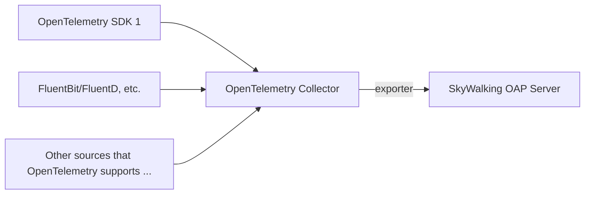

# OpenTelemetry Logging Format

SkyWalking can receive logs exported from OpenTelemetry collector, the data flow is:



Recommend to use [OpenTelemetry OTLP Exporter](#opentelemetry-otlp-exporter) to forward collected logs to OAP server in OTLP
format, and SkyWalking OAP is responsible for transforming the data format into native log format with analysis support
powered by [LAL script](../../concepts-and-designs/lal.md).

___
Deprecated: unmaintained and not recommended to use, will be removed.

[OpenTelemetry SkyWalking Exporter](https://github.com/open-telemetry/opentelemetry-collector-contrib/tree/5133f4ccd69fa40d016c5b7f2198fb6ac61007b4/exporter/skywalkingexporter) was first added into `open-telemetry/opentelemetry-collector-contrib` before 
OAP OTLP support. It transforms the logs to SkyWalking format before sending them to SkyWalking OAP. Currently, from OTLP
community, it is not well maintained, and already being marked as `unmaintained`, and may be removed in 2024.
___

## OpenTelemetry OTLP Exporter

By using this exporter, you can send any log data to SkyWalking OAP as long as the data is in OTLP format, no matter
where the data is generated.

To enable this exporter, make sure the `receiver-otel` is enabled and the `otlp-logs` value is in
the `receiver-otel/default/enabledHandlers` configuration section:

```yaml
receiver-otel:
  selector: ${SW_OTEL_RECEIVER:default}
  default:
    enabledHandlers: ${SW_OTEL_RECEIVER_ENABLED_HANDLERS:"otlp-metrics,otlp-logs"}
```

Also, because most of the language SDKs of OpenTelemetry do not support logging feature (yet) or the logging feature is
experimental, it's your responsibility to make sure the reported log data contains the following attributes, otherwise
SkyWalking is not able to consume them:

- `service.name`: the name of the service that generates the log data.

And several attributes are optional as add-on information for the logs before analyzing.
- `service.layer`: the layer of the service that generates the logs. The default value is `GENERAL` layer, which is 100% sampled defined by [LAL general rule](https://github.com/apache/skywalking/blob/master/oap-server/server-starter/src/main/resources/lal/default.yaml)
- `service.instance`: the instance name that generates the logs. The default value is empty.

Note, that these attributes should be set manually through OpenTelemetry SDK or through [attribute#insert in OpenTelemetry Collector](https://github.com/open-telemetry/opentelemetry-collector-contrib/blob/main/processor/attributesprocessor/README.md).

The OTLP log record body is delivered to [LAL](../../concepts-and-designs/lal.md) as a plain-text body, even when the string content is JSON-shaped. A LAL rule can still parse such content with the `json {}` parser — when the JSON body is empty and a text body is present, `json {}` tries the text as JSON. On a successful parse the log is normalized to a JSON body, so it is stored and rendered as JSON. See [`json`](../../concepts-and-designs/lal.md#json) for details.

A log record's attributes become the log's tags. Its `severity_number` adds two more:

- `severity`: the `SeverityNumber` enum constant, such as `SEVERITY_NUMBER_INFO`, `SEVERITY_NUMBER_INFO2` or
  `SEVERITY_NUMBER_ERROR`.
- `level`: the name of the number's range, `TRACE` (1-4), `DEBUG` (5-8), `INFO` (9-12), `WARN` (13-16), `ERROR` (17-20)
  or `FATAL` (21-24), so `SEVERITY_NUMBER_INFO2` is `INFO` and `SEVERITY_NUMBER_ERROR3` is `ERROR`.

The number is used rather than the free-form `severity_text`, which differs between SDKs (`INFO`, `info`,
`Information`). A record with no severity number, such as an Envoy access log, gets neither tag, and a record attribute
named `severity` or `level` is kept instead.

### Searchable tags

The tags OTLP logs can be searched by, and that tag autocomplete offers, are set by `otlpLogSearchableTags`, apart from
core's `searchableLogsTags`, which the logs of the SkyWalking native protocols keep:

```yaml
receiver-otel:
  default:
    otlpLogSearchableTags: ${SW_OTEL_LOG_SEARCHABLE_TAG_KEYS:level,severity,ai_route_type}
```

- A key is a log record attribute, such as `http.response.status_code`, the `severity` or `level` tag, or a tag a LAL rule
  adds, such as the Envoy AI Gateway rule's `ai_route_type`.
- Resource attributes are not stored with a log. To search by one, copy it to a tag in a LAL rule, for example
  `tag 'deployment.environment.name': sourceAttribute("deployment.environment.name")`, and list that tag.
- List low-cardinality keys only: every distinct value of a searchable tag is stored for tag autocomplete.
- A tag whose `key=value` is longer than 256 characters is not made searchable, though it is still stored with the log.
- An empty list makes OTLP logs use core's `searchableLogsTags`.

The log query accepts a key of either list, since all logs are stored together.

A log record written inside a span carries that span's `trace_id` and `span_id`. Both are stored with the log, as
lowercase hex: the trace ID as the log's trace ID, and the span ID as its OTLP span ID — not the `spanId`, which is a
SkyWalking span's number within its segment. So the log can be queried by the trace that wrote it, through
`relatedTrace { traceId }`, and by the span, through `relatedTrace { traceId, otlpSpanId }`. A LAL rule reads the span ID as
`log.traceContext.otlpSpanId`, and may set it with [`otlpSpanId`](../../concepts-and-designs/lal.md#extractor).

The trace ID is written the way this OAP stores the OTLP trace itself: with `otlpTraceStorage: zipkin`, an ID whose upper
64 bits are zero — a trace started by a tracer with 64-bit IDs — keeps only its lower 16 hex characters, as Zipkin does.
